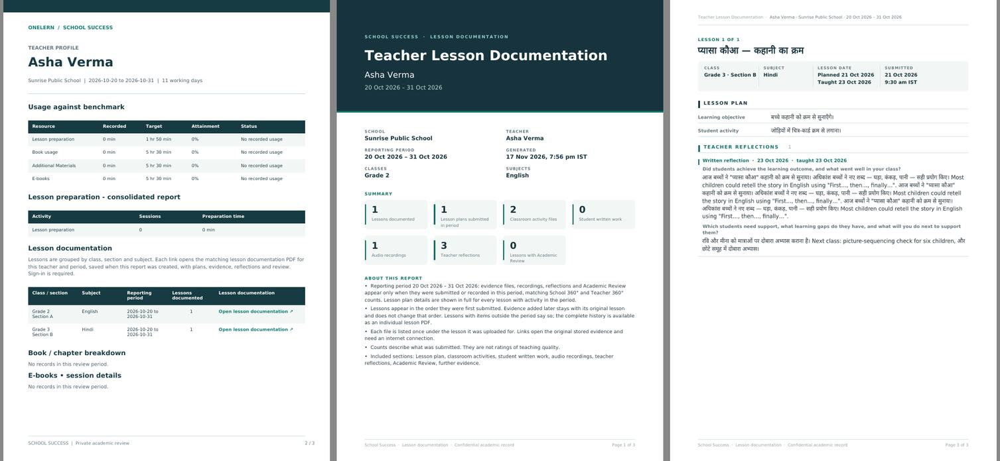

# Direct lesson-documentation PDFs from Teacher 360° usage reports

17 November 2026. Scope: School Success Teacher 360° exports (individual PDF, combined PDF, per-school ZIP).

## Behaviour

Clicking **Open lesson documentation ↗** in a usage PDF now opens the matching **Teacher Lesson Documentation PDF** directly. The scope is exact (school, teacher, class, section, subject and reporting period), for example AKANSHA PAL · Grade 1 · Mathematics · 1–17 November. There is no intermediate page with another download button.

**Export:**
- For every teacher × class × section × subject group in the export, the browser renders the PDF with the existing generator: same `buildLessonRecords` selection, period rules, submission order, Hindi canvas shaping, written reflections and image fallback.
- Each PDF is stored, and the parent usage PDF is created only after **all** groups are stored and confirmed.
- Progress is shown ("Preparing lesson documentation PDFs n of N").
- Limits:
  - 2 groups render at a time, and at most 300 groups per export.
  - Each PDF stays at or under 4 MB, the Vercel function payload limit. A larger one is re-rendered with 2 thumbnails per section, then with links only.
- Storage failures retry up to 3 times. Permission or validation errors are not retried. If any group still fails, **no report is produced** and the failed teacher, class and subject groups are listed, so there are no broken links and no silent omissions.
- Repeat exports of unchanged loaded data reuse stored snapshots, so there are no duplicate files.

**The link** is a durable application address, `https://<app>/school-success/report/<snapshot-id>`. Opening it works as follows:
1. **Signed out:** Vision sign-in, then back to the same address (allow-listed in `lib/return-path.js`).
2. **Signed in:** the page asks `POST /api/school-success/report-snapshots/<id>`. The server decrypts the snapshot and checks its stored school against the reader's School Success grant. It then issues a 2-minute ticket bound to that snapshot and reader.
3. The page navigates to `GET /api/school-success/report-snapshots/<id>?ticket=…`, which returns `application/pdf` with `Content-Disposition: inline; filename="Lesson_Documentation_<teacher>_<class>_<section>_<subject>_<from>_<to>.pdf"`, `Cache-Control: private, no-store` and `Referrer-Policy: no-referrer`.
   - "download it" on the page uses `&download=1` (attachment) for devices without an inline viewer.
   - An expired or missing ticket, for example a bookmarked API address, redirects back through step 2.
4. Readers without access to that school see "School is outside your assignment". Altered or unknown IDs show "not found".

Old `view=lesson-docs` links in earlier reports keep working.

## Storage and security (no migration, no new service, no bucket change)

- **Location:** the existing R2 bucket, using the server's existing credentials, at `school-success/report-snapshots/v1/<id>.bin`.
- **Encryption:** the bucket is publicly readable, so each snapshot is **AES-256-GCM encrypted** before upload.
  - The key is derived with HKDF-SHA-256 from the existing server secret `SCHOOL_SUCCESS_SIGNING_KEY`.
  - The snapshot ID is the authenticated data. A public storage URL therefore yields ciphertext only, and an envelope cannot be replayed under another ID.
- **Scope metadata** lives inside the encrypted envelope, so no table is needed. It includes school, teacher, class, section, subject, period, generated-at time, PDF SHA-256, size and who stored it.
- **Snapshot ID:** an HMAC of the scope, the generated-at time and the PDF hash, formatted as a UUID. It is deterministic for retries and unguessable without the secret.
  - Writes skip an existing object and send `If-None-Match: *`, so a snapshot is never overwritten.
  - A later export, after new evidence, creates a new snapshot; earlier reports keep their exact content.
- **Who can store:** only School Success administrators and consultants, for schools in their grant. Teacher school links cannot store or open snapshots. URL parameters never grant access.
- No credentials, service keys, teacher tokens, blob URLs or storage URLs are placed in exported PDFs.

## Verification

- `node --test tests/*.test.mjs tests/*.test.cjs`: **204 passed**. `npm run build` passed.
- New `tests/success-report-snapshots.test.mjs` covers:
  - encryption, ID binding and tamper detection;
  - deterministic IDs;
  - scope, PDF and size validation;
  - safe filenames;
  - exact-group rendering and submission order;
  - retries, permanent errors and aborting without a report;
  - thumbnail fallback;
  - snapshot reuse;
  - the concurrency bound, progress and limits;
  - the upload format;
  - the viewer's sign-in, return, 403, 404 and open flows;
  - the return-path allow-list.
- New `tests/success-report-snapshot-route.test.cjs` covers the real routes with an in-memory R2 and real crypto:
  - store once, ciphertext only;
  - refusal outside the grant, for teachers, signed out, for non-PDFs, over-long periods, extra fields and files over 4 MB;
  - a ticket, then an inline PDF with a filename, plus download;
  - other schools, altered IDs, crossed, expired, forged and missing tickets;
  - immutability after a later export;
  - tampered storage answering 404.
- **End-to-end** in headless Chromium, with the real Teacher 360° workspace and real routes behind request interception (synthetic data, in-memory R2):
  - Teacher, combined and ZIP exports stored 2, then +1, then +0 snapshots.
  - Links taken out of the downloaded usage PDFs, opened in a fresh browser context, served `application/pdf` inline with the exact-scope filename.
  - A signed-out reader returned to the PDF after sign-in. The sign-in step was a stand-in that uses the same `lib/return-path.js` rule as Vision's home page.
  - Another school's reader got "School is outside your assignment"; an altered ID got "not found".
  - Same headers on an emulated iPhone 13.
- The served PDFs were rendered and inspected: exact class/subject scope, cover with generated time, Hindi reflections.
- **Not verified live:** real Supabase sign-in, real R2 writes and reads (including `If-None-Match` support), and PDF viewers on physical phones.

## Limits and notes

### Viewing tickets are two-minute bearer links
- The `GET /api/school-success/report-snapshots/<id>?ticket=…` address that serves the PDF is a **bearer link**. Whoever holds it can open that one PDF, without signing in, until it expires.
  - A browser navigation to a PDF cannot carry the reader's Supabase bearer token. The access check therefore happens when the ticket is issued (the signed-in `POST`, which checks the stored school against the reader's grant), not when it is used.
  - The ticket records the reader's email but is not re-checked against a session on `GET`.
- **Limits on exposure:**
  - The ticket is HMAC-sealed and valid for **2 minutes**.
  - It opens only the snapshot it was issued for; a different ID redirects to sign-in.
  - Responses carry `Cache-Control: private, no-store` and `Referrer-Policy: no-referrer`.
  - After expiry, the address redirects to `/school-success/report/<id>`, which requires sign-in and the school grant again.
- **Residual risk:** a ticket URL copied, shared or captured (for example from browser history, a screen share or a proxy log) within those 2 minutes opens the PDF for anyone. The durable link printed in usage PDFs is `/school-success/report/<id>` and is **not** a bearer link.
- **Possible hardening (not implemented):** a single-use ticket would need server-side state, such as a table or key-value store. Binding the ticket to a session cookie would need cookie-based authentication.

### Rotating `SCHOOL_SUCCESS_SIGNING_KEY` currently makes existing snapshots unreadable
- The snapshot encryption key, the snapshot IDs and the viewing tickets are all derived from `SCHOOL_SUCCESS_SIGNING_KEY` (exposed to routes as `SUPABASE_GATEWAY_TOKEN` in `lib/school-success/environment.js`).
- **After a rotation:**
  - Every stored snapshot fails decryption and answers "not found". Every lesson-documentation link in usage PDFs exported before the rotation stops opening.
  - The encrypted objects remain in R2 but cannot be read without the old key.
  - Teachers' evidence and lesson records are not affected. Re-exporting the usage reports creates new, readable snapshots.
- The same secret also signs School Success evidence-upload plan tokens, so a rotation already interrupts in-flight submissions; teachers simply submit again.
- **Before rotating,** expect to re-export and re-distribute affected usage reports.
- **Possible remedy (not implemented):** a versioned key ring (for example `SCHOOL_SUCCESS_SNAPSHOT_KEYS` with a key ID stored in the envelope header) would let old snapshots stay readable after a rotation. This would need a new environment variable and owner approval.

### Other notes
- Snapshots are retained indefinitely; there is no deletion or retention policy yet.
- The PDF content is rendered in the exporting administrator's browser, and the server validates the PDF format and the school grant, not the PDF's lesson content.

## Rollback

- Redeploy the previous production deployment. Nothing in the database or settings changed.
- Snapshot links in reports exported under this release stop opening after a rollback, because the viewer route won't exist. Re-export reports after redeploying this release.
- Stored snapshot objects are inert encrypted files; nothing needs cleaning up.

