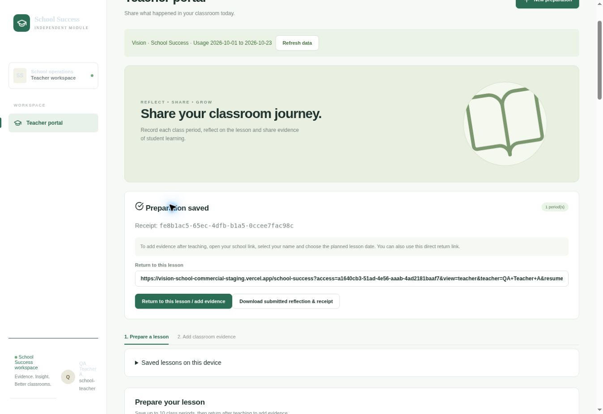
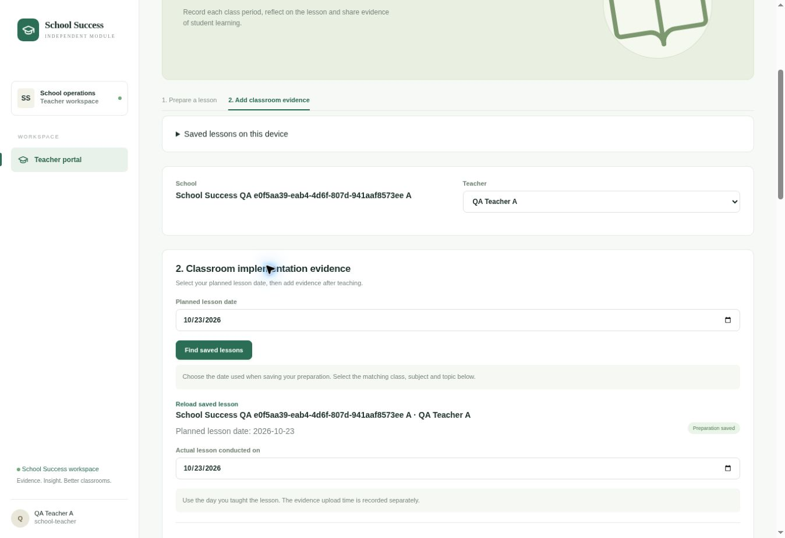

# School Success — independent Vision module

23 October 2026. This supersedes the mapping-based first-stage integration and the later restriction that disabled School Success school links.

Open https://vision-school-commercial-staging.vercel.app/school-success from **School Success folder** in Vision. It runs within the existing Next.js application and Vercel staging project.

## Programme boundary

| Workspace | Directory and records | Teacher workflow |
| --- | --- | --- |
| Vision literacy | Native `literacy_*` schools, classes, memberships, published competencies, assessments and reports | Native **Teacher Portal**, private Supabase Storage and separate signing key |
| School Success module | Copied `teacher_records`, `portal_*`, `success_*` configuration, own school/teacher directory, CRM, imports, archives, report settings and templates | Own school links, preparation, voice/text reflections, retained PDFs, later evidence and Teacher 360° reporting; existing R2 media |
| Original School Success site | Original Supabase/D1 records and settings | Continues independently at its existing URL |

Shared hosting and verified Vision sign-in do not merge the two programmes. No runtime School Success authorization or record assignment uses `success_school_mappings`, `success_teacher_mappings`, Vision school selections, classes or teacher memberships. Historical mapping rows are retained in the backup. No source customer records, source credentials or source deployment were changed for this release. There is no automatic synchronization between the original site and this module.

## Access and school links

Super Admin has full module access. **Module access** at `/school-success/access` assigns an existing, confirmed authentication user ID to explicitly selected School Success schools. It does not modify that account's Vision literacy roles or assignments. Consultants see only those selected module schools; revocation is enforced on the next request. Matching school names, teacher names or email addresses grants no protected access.

In **Teacher portal → School management sharing links**, management can generate or refresh a school link using the module's own active teacher directory. No Vision mapping is required. The school link opens without sign-in and permits selecting only that school's active teachers. School and individual teacher archives are rechecked on every request. Public school capabilities cannot read CRM, administrative settings, backups, or native Vision teacher APIs.

Fresh module tokens are stable once generated. Uploader identities are derived from the exact capability and selected module teacher; saved preparations, date lookup and return grants retain that identity. Source-site return tokens need not work here, as agreed. Device-saved links now use the correct `/school-success` path and module-specific storage keys.

All database service credentials, R2 credentials, signing and encryption keys remain server-side. Existing R2 configuration is decrypted with the established transfer key. This release does not rotate keys or move existing media.

## Original feature inventory and verification

The original source implementation remains the basis for the module. “Live API” below means the deployed application was exercised with temporary accounts and module-only schools. “Regression” means actual business/report code tests; it does not imply physical-device or signed-in browser acceptance.

| Feature | Status and evidence |
| --- | --- |
| Dashboard, overview, school/search/date filters | Original UI/calculations retained; live scoped data and roster checked |
| CRM tickets, follow-ups, notes; open/due/resolved | Live create, revision and resolution passed; date/status calculations regression passed |
| Pending/completed stakeholder connect calls | Live writes passed; unanswered calls excluded from two-connected-calls weekly KPI |
| Historical CRM archive and CSV downloads | Copied archive membership and legacy snapshots retained; export path preserved; every historical CSV not clicked in browser |
| Reusable editable call scripts and WhatsApp templates | Live save/reload/reuse and stale revision rejection passed |
| School/contact and teacher directory | Own module roster used; protected consultant school isolation passed |
| School/teacher archive and restore | Live passed; restoring a school keeps individually archived teachers archived; same public link resumes after restoration |
| Excel/CSV user metrics and deduplication | Same XLSX imported twice skipped existing session; new session retained; CSV normalization and validation regression passed |
| Usage and Teacher 360° reports | Original report UI and settings preserved; actual deployed data used for bulk generation |
| Consolidated opening and preparation sessions/minutes | Generated PDF text regression passed |
| Separate dated period comparison | Generated PDF text regression passed |
| Disabled KPI sections omitted from PDFs | Generated PDF text regression passed for cover, tables and comparison |
| Teacher evidence and consultant observations separately selected | Regression passed for all four toggle combinations; consultant observations remain excluded by default |
| Separate Book, E-book, Additional Materials | Aggregation regression passed |
| Individual/combined PDFs, school PDF ZIPs, workbook exports | Existing paths retained; actual deployed data generated combined PDF, two school PDFs in ZIP, and workbook summary; not every signed-in download button clicked live |
| Multi-period teacher preparation and structured reflection/TLM | Live API two-period save passed; real public browser form saved a typed preparation and generated its retained PDF |
| Voice recording and transcription choice | Original recording and browser speech workflow retained without an “optional” label; valid WAV retention/download tested; live speech and physical microphones untested |
| Preparation separate from post-teaching evidence | Live teacher/date lookup and direct return link passed; actual browser reopened saved preparation for later evidence |
| Successive evidence submissions / My Evidence | Live two updates retained earlier PDF/audio/photo/video links and separate dated events; browser displayed preparation and evidence history |
| School-specific public teacher links | Live anonymous access, foreign-teacher rejection, archive enforcement and administrative denial passed without Vision mappings |
| Large media uploads, R2 permissions and CORS | Live PDF, WAV, PNG and 6 MiB MP4 transport through direct R2 PUT passed; exact canonical-origin preflight passed; all saved URLs returned successful downloads |
| Super Admin database export | Live authenticated streaming NDJSON backup passed: 61,652 rows while fixtures were present; includes configuration, templates, archives and encrypted media settings |
| Vision data isolation | All native schools, memberships, lessons, public links and historical mapping rowsets compared unchanged before/after module writes; School Success capability denied on native Vision API |
| Original application independence | Original database still contains 61,523 source usage/lesson records; this release made no source writes |
| Mobile usability | Responsive source retained; physical iPhone Safari / Android Chrome and microphone/speech tests remain outstanding |

## Validation and limitations

- `node --test tests/vision-teacher-portal.test.mjs tests/success-*.test.mjs`: **45 passed**.
- Next.js production build passed.
- Active runtime commit: `73337e4a578347d824253ad36fe27944fb7104d4`; Vercel staging project `vision-school-commercial-staging`, production environment, Next.js. Deployment `dpl_BJ3g9vW3jVQPVNMRvV7NFwvkMpJ8` is **READY**, with the canonical `vision-school-commercial-staging.vercel.app` alias confirmed. A final error/fatal runtime-log scan returned no matching entries; this is a point-in-time check, not continuous monitoring.
- Deployed acceptance covered the boundaries above with disposable module schools and real temporary Supabase sessions. No native Vision school or teacher mapping was created for these tests.
- The 6 MiB MP4 test used synthetic bytes: it verifies transport, not movie playback. Audio used a valid WAV tone, not recorded speech.
- A protected, signed-in administrative browser session was unavailable; administrative workflows were tested through the deployed APIs. The public teacher workflow was exercised in the actual browser.
- The original baseline contains 61,523 usage/lesson records, not 61,523 teachers. The original site remains https://school-success-portal.harshitbhargava1997.chatgpt.site.

Cleanup completed: five disposable R2 objects, all four fixture accounts, module records, templates, links, grants and fixture state were removed by their exact run identity. The verification function now returns disabled status and requires JWT verification. Final read-only counts: 8 Vision schools, 43 Vision memberships, 2 native public link records, 2 historical implementation entries, no native lessons, 1 historical mapping row, and 61,523 copied School Success records. QA user/record/member/template/link/state counts are all zero. No QA credential values belong in source or documentation.
