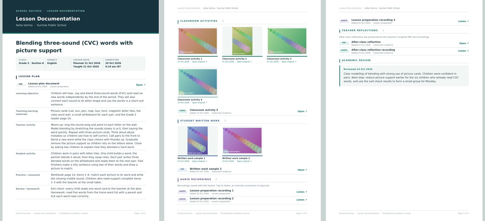
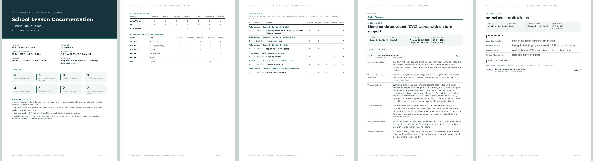
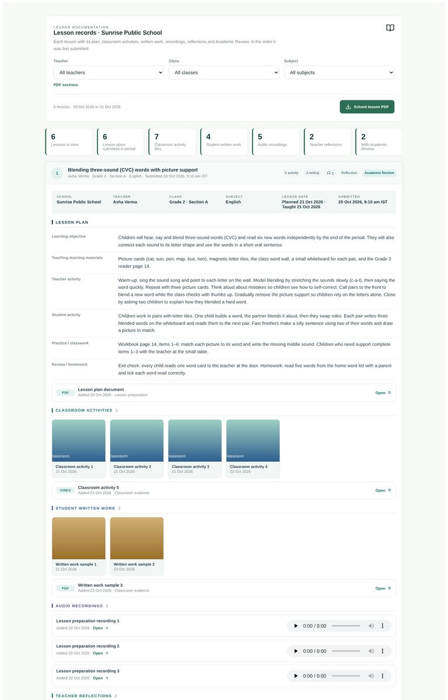
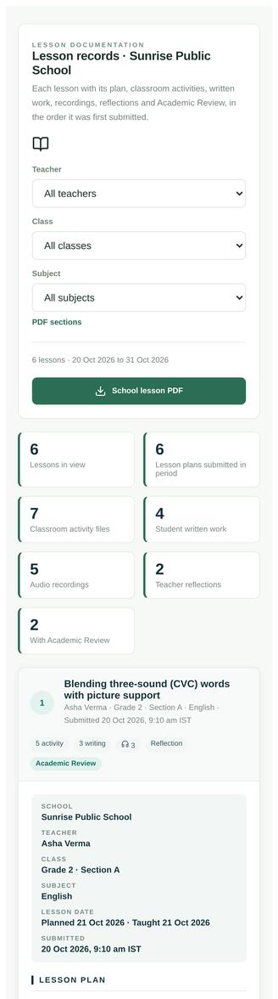

# School Success — lesson documentation

17 November 2026. Scope: the School Success module inside Vision (`/school-success`). Vision literacy, the native Teacher Portal and the original standalone School Success site are unchanged.

## What was added

- **Lesson records** view, on screen:
  - In Teacher 360°, below the existing teacher report.
  - In School 360° school detail, as a new **Lesson records** tab beside Teachers and Evidence flow.
  - One expandable card per lesson, in original submission order.
  - Filters by teacher (school view), class and subject, within the existing school and date scope.
  - Summary counts, PDF section choices and download buttons.
- Three new PDF types, all with the same design:
  1. **Individual Lesson Documentation PDF**: from a lesson card.
  2. **Teacher Lesson Documentation PDF**: cover with summary, chronological lesson index, then lesson-by-lesson records.
  3. **School Lesson Documentation PDF**: cover, teacher overview, class/subject breakdown, lesson index grouped School → Teacher → Class/Subject, then lesson records.
- Lesson section order: lesson plan → classroom activities → student written work → audio recordings → teacher reflections → Academic Review → further classroom evidence (phonics, portfolio, remedial, event pictures). Sections without content are omitted.
- Optional PDF sections: activities, written work, audio, reflections, Academic Review and further evidence. The lesson plan is always included. These choices are screen state only. They do not change saved Teacher 360° defaults or any record.

Existing Teacher 360°, School 360°, KPI, comparison, combined/ZIP PDFs, workbook and CSV exports are unchanged.

## Data rules (code-grounded)

- **Lesson identity:**
  - A lesson is one `teacher_records` row (one class period), keyed by school, teacher and record ID.
  - Evidence is the URLs stored on that same row, including later uploads recorded in `lesson_evidence_history`.
  - Nothing is matched by teacher name, date or topic.
  - Teachers with the same name at different schools stay separate.
- **Consultant classroom observations** have no lesson ID. They are not attached to lessons and remain in their existing separate sections.
- **Ordering:** earliest `preparation_saved_at` first, falling back to `submitted_at`, then the record ID when times tie. `implementation_date` and `StartTime` are rewritten when evidence is added, so they are never used for ordering.
- **Lesson plan fields:**
  - Parsed only from the exact prompt headings written by `formatReflection` (learning objective, materials, teacher activity, student activity, practice, review/next step).
  - Older free text is shown unchanged as "Lesson notes".
  - **CFU is not collected and is not shown.**
- **Audio:**
  - Preparation recordings (`Voice_Note_Link`, several per lesson) are labelled "Lesson preparation recording 1, 2…".
  - After-class reflection recordings and PDFs (`/closure/` paths) appear under Teacher reflections, following the existing reflection toggle semantics.
  - Written reflection text exists only inside the original PDF, so it is linked rather than reproduced.
- **Academic Review:**
  - The current `portal_evidence_reviews` feedback for that record, with its `updated_at` date.
  - No reviewer role or history is stored, so none is shown or invented. Reviewer emails are not carried into reports.
- **Counting:**
  - Each URL is counted once per lesson, however many updates re-sent it.
  - "Lesson plans submitted in period" matches School 360°'s existing *Prepared lessons* count.
  - Counts describe submissions, not teaching quality.
- **Access:**
  - Only the already-authorised `/api/school-success/portal` read response is used. No new API, query, database write, schema change, permission or R2 setting.
  - `mapLive` gained additive fields (`periodId`, `preparationSavedAt`, `lessonSubmittedAt`, `reviewedAt`, `evidenceEventId`, `evidenceEventAt`). They use new names, so existing `chronologicalRows` ordering is unchanged.

## Hindi / Devanagari

The existing report font (DejaVu Sans) has no Devanagari glyphs, and jsPDF cannot shape Indic scripts. The new PDFs therefore:

- draw any line containing Devanagari through the browser canvas with the bundled Noto Sans Devanagari, the same approach as the existing preparation PDF;
- keep English as selectable PDF text.

Hindi text in these PDFs is an image, so it is not searchable. Existing Teacher 360°/School 360° KPI PDFs keep their current font behaviour.

## Thumbnails and links

- Photo thumbnails are fetched in the browser from the existing stored URLs, downscaled to JPEG and embedded.
- Limits: 6 thumbnails per section per lesson, and 150 per PDF.
- If a photo cannot be fetched (for example if the bucket's cross-origin rules block it), the PDF shows it as a link and the screen says how many photos fell back.
- At most 400 lessons per PDF; larger selections are asked to narrow their filters.

## Security limitation: permanent public evidence URLs

Evidence links reuse the existing `R2_PUBLIC_BASE_URL` object URLs, as current reports already do. These URLs:

- do not expire;
- do not check who opens them;
- remain valid inside any shared PDF.

This release creates no new links and does not widen access: users only see lessons from schools their module grant allows. **Proposed future improvement (needs separate approval):**

- an authenticated redirect route that checks School Success access, then issues a short-lived signed R2 link;
- followed by a staged plan to stop public bucket reads.

That plan would need care for previously shared PDFs and for the original standalone site.

## Verification

- **Automated tests:**
  - New: `tests/success-lesson-records.test.mjs` (11), `tests/success-lesson-pdf.test.mjs` (8), `tests/success-lesson-records-ui.test.cjs` (5).
  - They cover ordering, filters, lesson-evidence association, multiple recordings, section toggles, Academic Review association, de-duplication, School 360° regression, PDF structure, links and the Devanagari rendering path.
  - Full suite: 147 passed. Production `next build` passed.
- **Visual inspection:**
  - Synthetic PDFs (fictional school and teachers) were generated in headless Chromium with real canvas shaping.
  - Pages were rendered with `pdftoppm` and inspected for: cover, index, long plans, multiple photos and writing samples, three recordings on one lesson, Hindi/English mixed text, multiple teachers and subjects, multi-page flow, missing evidence and all sections switched off.
  - Layout issues found during inspection were fixed before release:
    - duplicated header text;
    - an orphaned section heading;
    - uneven file tags;
    - cramped index and overview columns.
- **Browser checks:**
  - The on-screen view was checked at 1280 px and on an emulated iPhone 13, with no horizontal overflow.
  - School and lesson PDF downloads were clicked in Chromium, including one blocked image that correctly fell back to a link.
  - Non-Latin download names were found to be dropped by Chromium, so file names are now ASCII.
- **Not verified:**
  - signed-in use against real data;
  - whether the production R2 bucket allows cross-origin image reads (thumbnails fall back to links if not);
  - physical phones;
  - opening the PDFs in other viewers.

