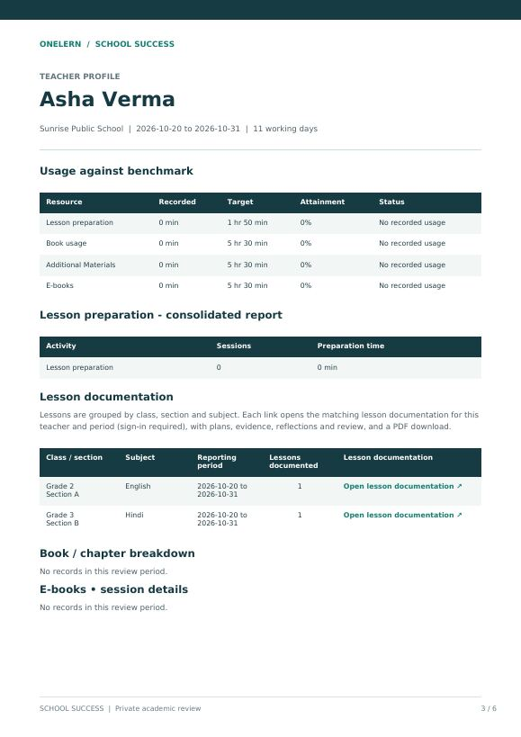
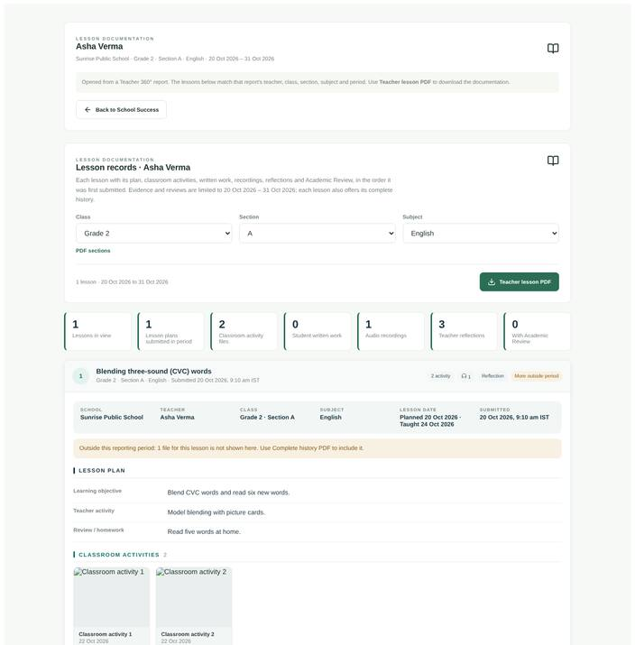
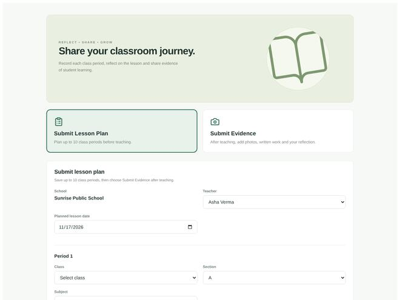
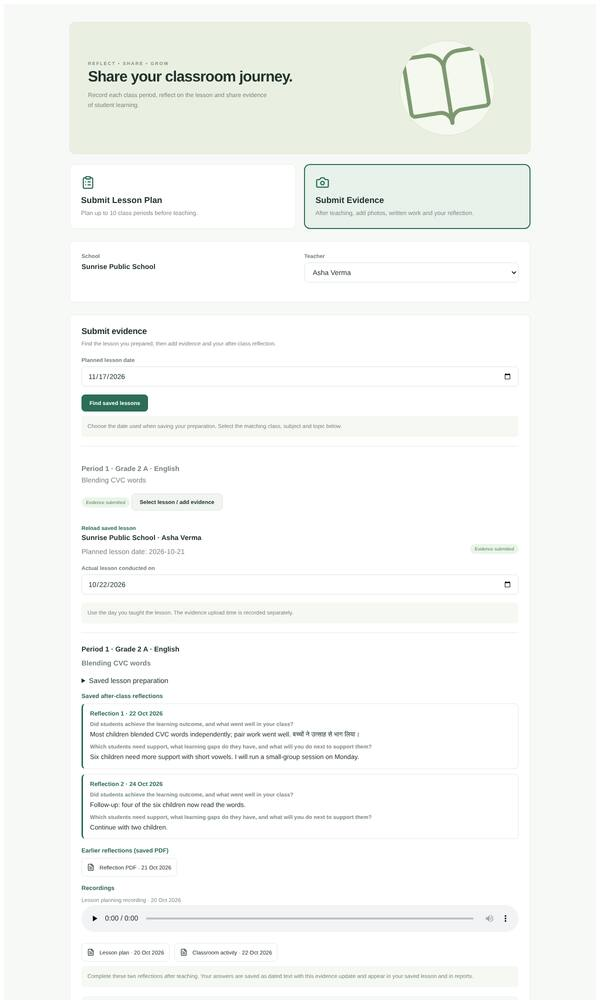
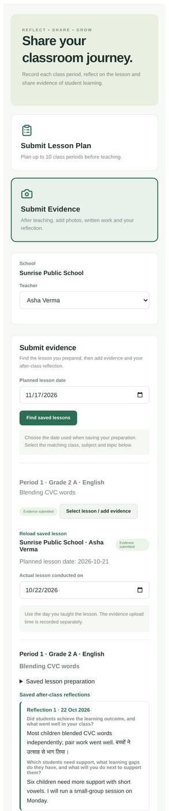

# Teacher 360° usage reports → lesson documentation, and written reflections

17 November 2026. Scope: School Success module (`/school-success`). School 360° portfolio reports are unchanged.

The native Vision teacher portal keeps its reflection PDFs. Vision's home page gains only an allow-listed return-after-sign-in step.

## What changed

1. **Usage PDFs link to lesson documentation.** This applies to the individual Teacher 360° PDF, the combined PDF and the per-school ZIP PDFs.
   - Each teacher page has a **Lesson documentation** table: class/section, subject, reporting period, *Lessons documented* (distinct lessons) and **Open lesson documentation ↗**.
   - Groups are built with the same `buildLessonRecords` period rules as the Teacher Lesson PDF, grouped by teacher, class, section and subject. All topics in a group are included.
2. **Usage PDFs stay focused.**
   - The separate *Lesson preparation PDFs*, *Audio recordings* and *After-class reflections* file lists are removed.
   - Activity, writing, phonics, portfolio, remedial and event-picture lists remain.
   - All KPI tables and calculations are unchanged; the *LP / Audio notes* evidence count still counts those files.
   - Nothing is deleted: audio and reflections remain in lesson records and lesson PDFs.
   - The Teacher 360° "After-class reflections · PDF and recording links" checkbox is removed because it no longer affects any output. The saved setting still parses.
3. **No duplicate generated plan links.**
   - The automatically generated preparation PDF is uploaded with *file ID = lesson-period ID* (`teacher-portal.jsx`), so its key ends in `implementation_
/lesson_plan/
.pdf`.
   - It is hidden only when the lesson's plan text is shown inline.
   - Uploaded plan photos and documents (random IDs) always remain. A plan whose only content is the saved PDF keeps it as a "Saved lesson plan (PDF)" fallback.
   - Provenance is checked by identity equality, never by file name.
4. **Written after-class reflections are stored as text.**
   - New School Success submissions send the two answers instead of generating a reflection PDF.
   - The answers appear in the expanded lesson record, in all three lesson PDFs, and in the School 360° evidence flow.

## Reflection storage (no migration)

The append-only evidence RPC (`school_success_append_lesson_evidence`) records file URLs per dated update in `lesson_evidence_history`. It has no text field, so a database column would need a migration. To avoid one:

The teacher sends the two answers for each class period with the evidence update. Each answer can contain up to 4,000 characters. The server validates the lesson and builds the reflection document. Its storage key depends on the update, period and exact contents. The signed plan holds the hashes that commit checks.

The current form sends the written reflection after the activity and student-work uploads. It uses a short-lived upload URL bound to the exact document checksum and a create-only write. The file picker accepts classroom media and PDFs. A teacher cannot select their own JSON attachment.

At commit the server verifies the stored reflection bytes or writes the prepared document itself. This also supports a form that was open before the update and a browser that lost its connection to storage. Commit checks the selected files and the existing database operation attaches everything to one dated history entry. A repeated submission receives the same receipt. When storage refuses a write, the response includes the operation, status and an available provider reference. The form retains the answers and skips previously uploaded files on the next submission unless the server identifies a missing file.

- **How text is read back:** `/api/school-success/portal` reads these documents server-side, only for records already returned to that caller and only from the configured media base, then validates them.
  - Limits: 400 per read, 64 KB each, an 8-second timeout, and schema validation.
  - Text is attached to the file entry. A failure leaves a labelled link ("Written reflection (open saved text)"); nothing is hidden.
- **Period rules:** written reflections follow the same IST-date rules as other evidence. Consolidated views show those in the period, the outside-period note counts the rest, and the Complete history PDF shows all of them.

A migration was considered and not needed. If one is wanted later, an append-only `success_lesson_reflections` table could replace the JSON documents.

## Historical reflections

- Earlier reflections exist only as saved PDFs. They remain listed as **Earlier after-class reflection (saved PDF)**, with a note that their text is in the original file.
- No OCR, backfill or record rewrite was performed.
- Recordings remain accessible.

## Links and access control

- **Link format:** `/school-success?view=lesson-docs&docSchool=…&docTeacher=…&docClass=…&docSection=…&docSubject=…&from=…&to=…` (plus `docArchived=1` when archived records were included).
  - Links use the application's own origin and carry no tokens or credentials. There is no public endpoint.
- **Parameters only pre-fill filters.**
  - The page loads data through the authenticated portal read, which applies the user's School Success module grant on the server.
  - Non-admins, schools outside the grant, malformed links, over-long values and ranges over 100 days show a clear "not available" or "not recognised" message.
  - Class, section and subject match exactly; a missing value never widens to "all".
- **Signed-out readers:** "Sign in to Vision" carries `?next=<link>`. After sign-in, Vision returns only to same-origin `/school-success` paths (`lib/return-path.js`); everything else is ignored.
- **The destination** shows the matching lessons with the filters applied and a **Teacher lesson PDF** download, the same generator as the Teacher Lesson PDF.

## Verification

- `node --test tests/*.test.mjs tests/*.test.cjs`: **173 passed**. New: `success-lesson-links`, `success-reflection-text`, plus additions to the lesson UI/records tests.
- Three existing tests that asserted the removed usage-PDF lists were updated intentionally.
- `npm run build` passed.
- **Visual and browser checks** used synthetic data in headless Chromium:
  - usage PDFs (single and combined) with documentation links;
  - lesson PDFs with two written reflections plus an earlier PDF-only reflection;
  - long mixed Hindi–English reflections;
  - a plan-PDF-only fallback.
- A link taken from a generated usage PDF was opened in a fresh browser context. It showed exactly the linked class, section and subject on desktop and an emulated iPhone 13, with no overflow, and its Teacher lesson PDF downloaded with only that lesson.
- Layout issues found and fixed: the link-table header and the link text wrapping.
- **Not verified:**
  - real signed-in sessions;
  - the Vision `?next=` redirect against live Supabase auth;
  - live R2 reads and writes of reflection documents;
  - physical phones.

## Known limitations

- Reflection documents live in R2 under the same permanent public-URL model as other evidence.
- The portal read now makes up to 400 small R2 reads, only for new text reflections in the range.
- The usage PDF still uses DejaVu Sans, so Hindi teacher or subject names there have the pre-existing glyph limitation. The lesson PDFs render Hindi correctly.
- Teachers' own resume view lists the stored reflection as a file link, so the raw JSON text opens in the browser.

## Rollback

- **Code:** revert the PR's merge commit, or redeploy the previous production deployment.
- **Data:**
  - No schema, RLS or setting changes are involved.
  - Reflection documents already saved stay as ordinary closure files in R2 and evidence history. After a rollback, the previous code lists them as links rather than showing their text.
  - No data needs to be removed.

## Review round 1 corrections (PR #6)

### A. Reflection retry safety
- **Accepted reflection content is immutable.**
  - Documents are deterministic: there is no `savedAt`, because the save time is the history event time.
  - Their storage key is content-addressed from (update ID, period ID, SHA-256 of the exact bytes).
  - Different answers can never reach an existing key. An identical retry maps to the same key with identical bytes.
- **Writes never overwrite.** They skip an object that already exists (`HEAD`) and send `If-None-Match: *`, so concurrent first writes cannot replace each other. A `412` is accepted only after the size is verified.
- **Conflicting or stale plans** can at most leave an unreferenced object. The RPC returns `alreadySaved` or `Lesson changed`, and history is unchanged.
- **Concurrency in the database:** the RPC already takes `pg_advisory_xact_lock(hashtext(p_submission), …)` before its checks, so commits for one submission are serialized. No migration is needed.

### B. Large submissions
- The base64url encoder is now chunked; before, spreading the bytes overflowed the call stack.
- **Plan tokens are bounded** (v2): they carry only identifiers, mode, version, update ID, conducted date, a SHA-256 of the final submission, and `{id, periodId, sha256, size}` per reflection.
- At commit the browser resends the submission and answers. The server rebuilds the exact prepared submission and refuses with `409` if anything differs.
- Token size depends only on the number of periods and files. Ten periods with two 4,000-character Hindi answers each, plus 5,000-character Hindi plans, produce a token under 4,000 characters, well within `unseal()`'s 200,000.
- Plans sealed by the previous code (which have no reflections) are still accepted for their one-hour lifetime.
- The browser keeps the teacher's typed reflection and chosen files on any error, with the same update ID, so resubmitting retries safely.

### C. Readable reflections for teachers
- The authorised resume API gives every file its IST submission date, from the evidence history, and attaches saved reflection text server-side.
- The reopened lesson shows dated reflections, each with *learning outcome and what went well* and *students needing support, gaps and next steps*.
- Earlier PDF-only reflections, recordings, other files and (for School Success administrators only, as before) Academic Review stay listed.
- No raw JSON is shown. The generated preparation PDF is hidden there too when the preparation text is shown.

### D. Simplified School Success teacher portal
- **Two primary actions:** **Submit Lesson Plan** and **Submit Evidence**.
- **Removed:**
  - Download reflection draft;
  - Download submitted reflection & receipt;
  - Download reflection & evidence links;
  - Download lesson & evidence links;
  - the bottom "Teacher evidence / My Evidence" feed, with its loaded-period line and entry count.
- **Kept:** the save confirmation and return link, the saved-lessons-on-this-device list, and the planned-date lookup (which uses its own API and is independent of the feed and its period).
- **Add Evidence** no longer shows the after-class audio recording or upload block. Historical audio remains listed and playable, and the optional lesson-planning recording is unchanged.
- **Shared components:** `ReflectionEditor` gained `audio` (default `true`) and `AfterClassReflection` an optional `note`, so native Vision behaves exactly as before. This is verified by test.

### Verification
- `node --test tests/*.test.mjs tests/*.test.cjs`: **190 passed**. `npm run build` passed.
- New route-level tests (`tests/success-evidence-route.test.cjs`) run the real route, sealing, schemas and workflow, with an in-memory R2 (honouring `If-None-Match`) and an emulated RPC. They cover:
  - identical retries;
  - conflicting plans sharing an update ID;
  - concurrent commits;
  - stale versions;
  - storage and database partial failures with retry;
  - tampering;
  - JSON upload rejection;
  - maximum-length English, Hindi and mixed 10-period submissions;
  - a 10-period maximum Hindi lesson plan;
  - dated reload of reflections with legacy files, and feedback only for admins.
- New UI tests (`tests/success-teacher-portal-ui.test.cjs`) check the two actions, the absence of the removed downloads, feed and audio controls, readable reloaded reflections, and that Vision still has audio.
- **Browser checks** (synthetic data, mocked API, headless Chromium) on desktop and an emulated iPhone 13: two actions, no downloads, no feed, and no sideways scrolling. Submit Evidence → find → reopen shows 2 dated reflections, no raw JSON and no reflection-audio control.
- Reporting PDFs were re-generated and inspected: usage links, lesson PDFs with written reflections, and the link destination with its download.
- **Not verified:** live authentication, real R2 conditional writes (`If-None-Match` support in the production bucket; without it the content-addressed keys still prevent overwrites), real RPC execution, and physical phones.

### Rollback
- Code only; no schema or settings changed.
- Reflection documents saved by this version are ordinary closure files that earlier code lists as links.
- Plan tokens are short-lived (1 hour). After a rollback, a teacher in the middle of a submission simply submits again.

