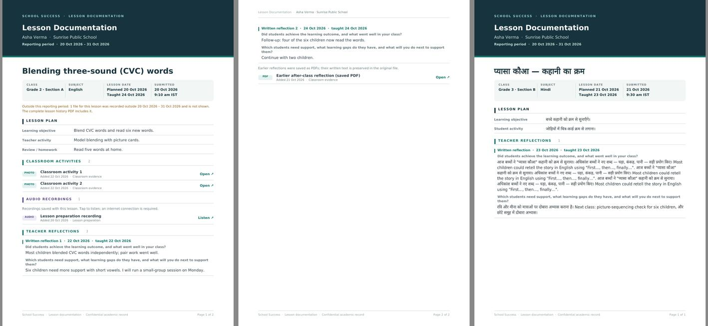

# Teacher 360° usage reports → lesson documentation, and written reflections

17 November 2026. Scope: School Success module (`/school-success`). School 360° portfolio reports are unchanged.

The native Vision teacher portal keeps its reflection PDFs. Vision's home page gains only an allow-listed return-after-sign-in step.

## What changed

1. **Usage PDFs link to lesson documentation.** This applies to the individual Teacher 360° PDF, the combined PDF and the per-school ZIP PDFs.
   - Each teacher page has a **Lesson documentation** table: class/section, subject, reporting period, *Lessons documented* (distinct lessons) and **Open lesson documentation ↗**.
   - Groups are built with the same `buildLessonRecords` period rules as the Teacher Lesson PDF, grouped by teacher, class, section and subject. All topics in a group are included.
2. **Usage PDFs stay focused.**
   - The separate *Lesson preparation PDFs*, *Audio recordings* and *After-class reflections* file lists are removed.
   - Activity, writing, phonics, portfolio, remedial and event-picture lists remain.
   - All KPI tables and calculations are unchanged; the *LP / Audio notes* evidence count still counts those files.
   - Nothing is deleted: audio and reflections remain in lesson records and lesson PDFs.
   - The Teacher 360° "After-class reflections · PDF and recording links" checkbox is removed because it no longer affects any output. The saved setting still parses.
3. **No duplicate generated plan links.**
   - The automatically generated preparation PDF is uploaded with *file ID = lesson-period ID* (`teacher-portal.jsx`), so its key ends in `implementation_
/lesson_plan/
.pdf`.
   - It is hidden only when the lesson's plan text is shown inline.
   - Uploaded plan photos and documents (random IDs) always remain. A plan whose only content is the saved PDF keeps it as a "Saved lesson plan (PDF)" fallback.
   - Provenance is checked by identity equality, never by file name.
4. **Written after-class reflections are stored as text.**
   - New School Success submissions send the two answers instead of generating a reflection PDF.
   - The answers appear in the expanded lesson record, in all three lesson PDFs, and in the School 360° evidence flow.

## Reflection storage (no migration)

The append-only evidence RPC (`school_success_append_lesson_evidence`) records file URLs per dated update in `lesson_evidence_history`. It has no text field, so a database column would need a migration. To avoid one:

- **What is sent:** the browser sends `reflections: [{periodId, answers:{achievement,nextStep}}]` with `prepare` (classroom-evidence mode only). Each answer is limited to 4,000 characters, and the period must belong to the lesson.
- **What the server builds:** a JSON document `{type:'school-success/after-class-reflection@1', submissionId, periodId, updateId, conductedOn, savedAt, prompts, answers}`.
  - Its file ID is derived deterministically from (update ID, period ID).
  - The server seals it into the signed plan token and adds it to the submission as a `closure` file at `…/implementation_<period>/closure/<id>.json`.
- **What happens at commit:** the server writes the document to R2 (an idempotent PUT to the same key). The existing size check and the RPC then record it in that update's dated history.
  - Retries with the same update ID return "already saved"; there are no duplicates.
  - Multiple updates create separate dated reflections.
- **Upload limits:** browsers cannot upload `.json` evidence; the prepare step rejects it.
- **How text is read back:** `/api/school-success/portal` reads these documents server-side, only for records already returned to that caller and only from the configured media base, then validates them.
  - Limits: 400 per read, 64 KB each, an 8-second timeout, and schema validation.
  - Text is attached to the file entry. A failure leaves a labelled link ("Written reflection (open saved text)"); nothing is hidden.
- **Period rules:** written reflections follow the same IST-date rules as other evidence. Consolidated views show those in the period, the outside-period note counts the rest, and the Complete history PDF shows all of them.

A migration was considered and not needed. If one is wanted later, an append-only `success_lesson_reflections` table could replace the JSON documents.

## Historical reflections

- Earlier reflections exist only as saved PDFs. They remain listed as **Earlier after-class reflection (saved PDF)**, with a note that their text is in the original file.
- No OCR, backfill or record rewrite was performed.
- Recordings remain accessible.

## Links and access control

- **Link format:** `/school-success?view=lesson-docs&docSchool=…&docTeacher=…&docClass=…&docSection=…&docSubject=…&from=…&to=…` (plus `docArchived=1` when archived records were included).
  - Links use the application's own origin and carry no tokens or credentials. There is no public endpoint.
- **Parameters only pre-fill filters.**
  - The page loads data through the authenticated portal read, which applies the user's School Success module grant on the server.
  - Non-admins, schools outside the grant, malformed links, over-long values and ranges over 100 days show a clear "not available" or "not recognised" message.
  - Class, section and subject match exactly; a missing value never widens to "all".
- **Signed-out readers:** "Sign in to Vision" carries `?next=<link>`. After sign-in, Vision returns only to same-origin `/school-success` paths (`lib/return-path.js`); everything else is ignored.
- **The destination** shows the matching lessons with the filters applied and a **Teacher lesson PDF** download, the same generator as the Teacher Lesson PDF.

## Verification

- `node --test tests/*.test.mjs tests/*.test.cjs`: **173 passed**. New: `success-lesson-links`, `success-reflection-text`, plus additions to the lesson UI/records tests.
- Three existing tests that asserted the removed usage-PDF lists were updated intentionally.
- `npm run build` passed.
- **Visual and browser checks** used synthetic data in headless Chromium:
  - usage PDFs (single and combined) with documentation links;
  - lesson PDFs with two written reflections plus an earlier PDF-only reflection;
  - long mixed Hindi–English reflections;
  - a plan-PDF-only fallback.
- A link taken from a generated usage PDF was opened in a fresh browser context. It showed exactly the linked class, section and subject on desktop and an emulated iPhone 13, with no overflow, and its Teacher lesson PDF downloaded with only that lesson.
- Layout issues found and fixed: the link-table header and the link text wrapping.
- **Not verified:**
  - real signed-in sessions;
  - the Vision `?next=` redirect against live Supabase auth;
  - live R2 reads and writes of reflection documents;
  - physical phones.

## Known limitations

- Reflection documents live in R2 under the same permanent public-URL model as other evidence.
- The portal read now makes up to 400 small R2 reads, only for new text reflections in the range.
- The usage PDF still uses DejaVu Sans, so Hindi teacher or subject names there have the pre-existing glyph limitation. The lesson PDFs render Hindi correctly.
- Teachers' own resume view lists the stored reflection as a file link, so the raw JSON text opens in the browser.

## Rollback

- **Code:** revert the PR's merge commit, or redeploy the previous production deployment.
- **Data:**
  - No schema, RLS or setting changes are involved.
  - Reflection documents already saved stay as ordinary closure files in R2 and evidence history. After a rollback, the previous code lists them as links rather than showing their text.
  - No data needs to be removed.

