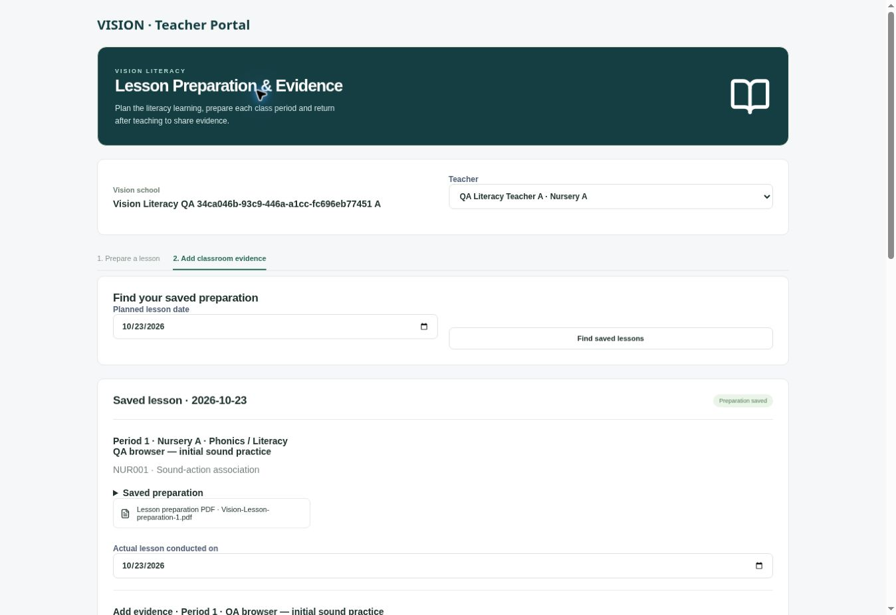

# Vision literacy Teacher Portal

22 October 2026. This supersedes the earlier full School Success integration direction.

Vision's main navigation contains **Teacher Portal**. Its directory uses the selected Vision school, teacher membership IDs and class assignments. Preparation uses Vision's published literacy competencies. No School Success mapping is required.

The portal retains structured typed or spoken planning, teaching-learning materials, multiple periods, generated preparation PDFs, audio recordings, teacher/date lookup, subsequent evidence updates, file downloads and leader feedback. Voice recording is a choice. Preparations and each later evidence update remain distinct. Competency proficiency is established through assessments, not inferred from an upload.

New lesson data lives in `literacy_teacher_lessons`. School teacher capabilities live in `literacy_teacher_portal_links`; only token hashes are stored. New media uses the existing private `vision-implementation` bucket under a `teacher-portal/<school ID>/<teacher ID>/...` prefix. Signed uploads go directly from browser to Supabase Storage. They do not pass file bodies through Vercel. Signed download grants are specific to a file, school and teacher, with an independent `VISION_TEACHER_PORTAL_SIGNING_KEY` configured server-side in Vercel production. Public-link media grants are invalidated when that link is revoked.

Protected requests validate Vision authentication and implementation permissions. Teachers see their own work. Principals/coordinators/consultants with implementation review permission see only their assigned schools. Public teacher links select from native Vision teacher IDs and do not grant CRM or administrative access. User-management permission is needed to create/revoke public school links.

Teacher and school progress reports combine the native Vision implementation history and new Vision lessons. Preparations/sessions/minutes are shown separately from implemented periods. School Success records never enter these reports. Historical implementation attachments remain accessible through the read-only **Implementation history** navigation item.

**School Success folder** remains a separate Super Admin entry. Its copied records, CRM, templates, archives and reports are retained. Ordinary Vision stakeholders cannot access that folder; its old shared capabilities and school/teacher mapping controls are paused. The existing mapping rows are retained as history but no longer authorize access. The independent original School Success portal is unchanged and remains at https://school-success-portal.harshitbhargava1997.chatgpt.site.

Validation: Next.js production build passed. `node --test tests/vision-teacher-portal.test.mjs tests/success-*.test.mjs` passed 43 tests.

Deployed acceptance passed eight scenarios using disposable Vision schools/accounts: anonymous/foreign-school denial; School Success folder separation and Super Admin access; native public school links without mappings; foreign-class and incomplete-upload rejection; two-period preparation with retained PDF/audio, idempotent commit and shared public/signed-in teacher identity; a 6 MiB direct upload and two successive evidence updates; principal feedback and Vision progress counts that distinguish preparations from implemented periods; and revocation that blocks public forms/media while retaining signed-in teacher access. The report checks also confirmed that submitting evidence did not create competency assessment ratings.

The actual desktop browser form saved a typed literacy preparation with a selected Nursery competency and generated its PDF, then opened that preparation for later evidence. A banner style conflict found during visual verification was corrected. The API video test used synthetic bytes to verify transport, not a decodable movie. Audio retention used a valid WAV file, not live speech. Real microphone/speech recognition on physical iPhone Safari and Android Chrome remains untested. Protected-role API access was exercised with real temporary Supabase sessions; a signed-in protected browser session was not available for visual verification of the main sidebar.

The saved return link was opened in a fresh page after deployment and restored the correct teacher, class, competency, preparation and PDF. The verified teacher-form view is included below using a disposable test school; its links are revoked after testing.

Active deployment: https://vision-school-commercial-staging.vercel.app/ — Vercel `dpl_GdY4mGc3dDkr4hvY5qoh4vfDYifY`, READY, runtime commit `6dcea40967646d85fcc5dc1357e14ab122cbe3bb`, Next.js. This is the production environment of the existing staging project. Final error/fatal runtime-log scan returned no matching entries; this is not continuous monitoring.

Cleanup completed: disposable schools/accounts, native QA lessons, public links and uploaded media were removed. The temporary verification Edge Function is disabled and again requires JWT verification. Read-only final checks confirmed zero QA schools/users/media, with the original 8 Vision schools, 43 memberships, 2 historical implementation entries and 61,523 copied School Success records retained. The original independent School Success application was not modified for this change.
